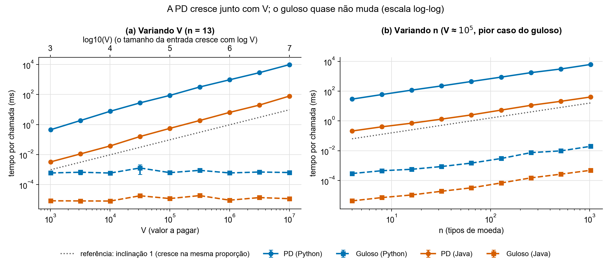

# Troco de moedas: guloso × programação dinâmica

**CESAR School** · Ciência da Computação · **Teoria da Computação** · Prof. Daniel Bezerra · 2026.2

Equipe:
- Erick Acioli Belo
- José Braz
- Luis Guilherme Alves
- Júlio Cesar
- João Luiz

## Resumo

Problema: pagar um valor V com o **menor número de moedas**, tendo n tipos de moeda à vontade.

- **Algoritmo A, guloso:** pega sempre a maior moeda que cabe. É rapidíssimo, mas só acerta em sistemas "canônicos", como o real.
- **Algoritmo B, programação dinâmica (PD):** monta uma tabela com a melhor resposta para cada valor de 0 até V. Sempre acerta, mas o custo cresce com V.

Os dois foram implementados em **Python** e em **Java** (4 implementações), medidos sobre as mesmas entradas e comparados com a teoria.

## Links principais

- Relatório (PDF): [relatorio/relatorio_troco_de_moedas_v1.pdf](relatorio/relatorio_troco_de_moedas_v1.pdf)
- Resultados consolidados: [resultados/resumo.csv](resultados/resumo.csv) · ajustes log-log: [resultados/ajustes.csv](resultados/ajustes.csv)
- Gráficos: [graficos/](graficos/)

## Entregas

| Exigência do enunciado | Onde está |
|---|---|
| 4 implementações (2 algoritmos × 2 linguagens) | [src/python/troco.py](src/python/troco.py), [src/java/Troco.java](src/java/Troco.java) |
| Script de geração de entradas (semente fixa) | [scripts/gerar_entradas.py](scripts/gerar_entradas.py) → [entradas/](entradas/) |
| Script de medição | [src/python/medir.py](src/python/medir.py), [src/java/Medir.java](src/java/Medir.java) |
| Testes de corretude | [testes/test_troco.py](testes/test_troco.py) |
| Scripts dos gráficos | [scripts/graficos.py](scripts/graficos.py), [scripts/analisar_sistemas.py](scripts/analisar_sistemas.py) |
| Resultados brutos | [resultados/](resultados/) |
| Relatório PDF (7 itens, ambiente, contribuições) | [relatorio/](relatorio/) |
| README reprodutível | este arquivo · tudo roda com [scripts/rodar_tudo.py](scripts/rodar_tudo.py) |

## Pastas

```
.
├── src/python/        troco.py (guloso e PD) e medir.py (cronometragem)
├── src/java/          Troco.java (guloso e PD) e Medir.java (cronometragem)
├── scripts/           gerar_entradas.py, rodar_tudo.py, graficos.py, analisar_sistemas.py
├── testes/            test_troco.py (corretude das 4 implementações)
├── entradas/          instâncias geradas (semente 2026), lidas pelas 4 implementações
├── resultados/        CSV brutos de tempo e memória, resumo, ajustes, ambiente.txt
├── graficos/          figuras usadas no relatório
└── relatorio/         relatório em PDF
```

## Como funciona

Pense num caixa de supermercado. O **guloso** é o caixa experiente: pega a maior nota que cabe no troco e repete. A **PD** é o caixa cuidadoso: antes de responder, anota num caderno o melhor troco para R$ 0,01, R$ 0,02, … até o valor pedido.

1. `gerar_entradas.py` cria as instâncias (valor V e lista de moedas) com semente fixa e grava em `entradas/`.
2. As quatro implementações leem os mesmos arquivos.
3. `medir.py` / `Medir.java` cronometram **só a chamada do algoritmo**, em lotes de N chamadas (N dobra até o lote durar ≥ 10 ms), com 20 repetições, aquecimento e descarte.
4. `test_troco.py` confere: PD = força bruta, Java = Python, guloso = PD nos sistemas canônicos e guloso ≠ PD nos contraexemplos.
5. `graficos.py` calcula média, desvio-padrão, razão T(n)/f(n), expoente log-log e desenha as figuras.

## Como reproduzir

Pré-requisitos: Python 3.10+ e JDK 21+ (testado com Python 3.12.2 e Java 25.0.1) no PATH.

```bash
python -m venv .venv
# Windows: .venv\Scripts\activate    |    Linux/macOS: source .venv/bin/activate
pip install -r requirements.txt

python scripts/rodar_tudo.py --rapido   # versão reduzida, cerca de 1 min, saída em saida_rapida/
python scripts/rodar_tudo.py            # completo, cerca de 30 min, regrava resultados/ e graficos/
```

Só os testes: `python -m unittest discover -s testes -v` (compila o Java sozinho).

## Respostas às perguntas do enunciado

1. **Problema e algoritmos:** guloso (maior moeda primeiro, com divisão inteira) e PD (`dp[v] = min(dp[v−c] + 1)`). Relatório, seção 1.
2. **Classificação:** guloso O(n) e Ω(1) no laço (Θ(n) no pior caso, Θ(1) no melhor), O(n log n) contando a ordenação. PD Θ(n·V) de tempo e Θ(V) de espaço. Seção 2.
3. **Casos:** guloso melhor = V múltiplo da maior moeda (1 iteração); pior = o resto só zera na última moeda (n iterações); médio (n+1)/2 iterações. A PD não tem melhor nem pior caso. Seção 3.
4. **Aplicabilidade:** guloso em sistemas canônicos (real, euro, dólar), com qualquer V. PD em sistemas arbitrários com V moderado. Seção 4.
5. **Simulação:** E1 varia V de 10³ a 10⁷ (9 tamanhos); E2 varia n de 4 a 1024 (9 tamanhos) nos 3 casos. Seção 5.
6. **Gráficos e tabelas:** teórico × medido, algoritmo × algoritmo, linguagem × linguagem, casos e memória. Seção 6.
7. **P × NP:** a decisão "dá para pagar V com ≤ k moedas?" está em NP (o certificado são as quantidades) e é NP-completa (Lueker, 1975). A PD é **pseudopolinomial**: polinomial no valor de V, exponencial no número de dígitos de V. Seção 7.

## Resultados principais

Tempo médio por chamada, experimento E1 (sistema do real em centavos, n = 13, 20 repetições):

| V | Guloso Python | Guloso Java | PD Python | PD Java |
| ---: | ---: | ---: | ---: | ---: |
| 1.016 | 590,3 ns | 8,2 ns | 453,20 µs | 3,25 µs |
| 3.203 | 659,7 ns | 8,1 ns | 1,85 ms | 11,02 µs |
| 10.065 | 583,2 ns | 7,9 ns | 7,67 ms | 37,60 µs |
| 31.689 | 1,27 µs | 17,8 ns | 27,80 ms | 158,40 µs |
| 100.083 | 619,1 ns | 11,6 ns | 87,52 ms | 554,20 µs |
| 316.242 | 883,2 ns | 18,3 ns | 318,40 ms | 1,86 ms |
| 1.000.029 | 591,3 ns | 9,0 ns | 961,40 ms | 6,43 ms |
| 3.162.355 | 681,9 ns | 13,5 ns | 2,87 s | 19,89 ms |
| 10.000.080 | 629,9 ns | 11,3 ns | 9,84 s | 78,55 ms |



- PD: expoente log-log 1,07 (Python) e 1,10 (Java), perto do 1 previsto por Θ(n·V).
- Guloso: tempo constante em V (expoente 0,00 / 0,05).
- Com V = 10.000.080: PD 9,84 s (Python) e 78,55 ms (Java); guloso 629,9 ns e 11,3 ns.
- Na PD o Python foi de 125 a 204 vezes mais lento que o Java. A constante muda; o expoente, não.

**Limitações:**

- Uma única máquina (notebook). Os tempos absolutos dependem dela; as tendências, não.
- A PD em Python vai só até V = 10⁷ por causa do tempo e da memória.
- O guloso só foi medido em sistemas canônicos. Em sistemas não canônicos ele é igualmente rápido, mas erra (relatório, Tabela 2).

## O que foi além do pedido e por quê

| Extra | Por quê |
|---|---|
| Medição de memória e comparação com Θ(V) ([fig5](graficos/fig5_memoria.png)) | Bônus de até 0,5 previsto no enunciado |
| Verificação automática de que os sistemas do benchmark são canônicos (limite de Kozen e Zaks) | Garante que as 4 implementações devem coincidir; reduz o risco de erro |
| Análise de sistemas aleatórios ([scripts/analisar_sistemas.py](scripts/analisar_sistemas.py)) | Dá números concretos ao item 4 (com que frequência o guloso erra) |
| Expoente do ajuste log-log ([resultados/ajustes.csv](resultados/ajustes.csv)) | Compara teoria e medição com um número, além do gráfico |
| Modo `--rapido` | Qualquer pessoa confere a reprodução em cerca de 1 minuto |

## Ambiente de execução

- CPU: AMD Ryzen 7 7730U with Radeon Graphics
- RAM: 15.3 GiB
- Sistema operacional: Windows-11-10.0.26200-SP0
- Plano de energia: GUID do Esquema de Energia: 381b4222-f694-41f0-9685-ff5bb260df2e  (Equilibrado)
- Python: CPython 3.12.2 (sem flags)
- Java (execução): java version "25.0.1" 2025-10-21 LTS
- Java (compilador): javac 25.0.1 (flags: nenhuma; JIT HotSpot padrão)

## Contribuições

O que cada integrante fez e a declaração exigida pela disciplina estão nas seções 9 e 10 do [relatório](relatorio/relatorio_troco_de_moedas_v1.pdf).
