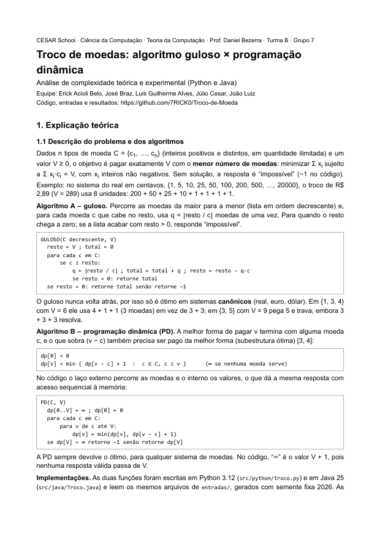
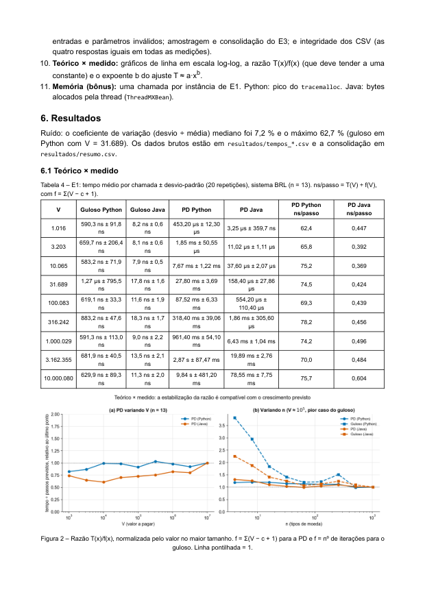
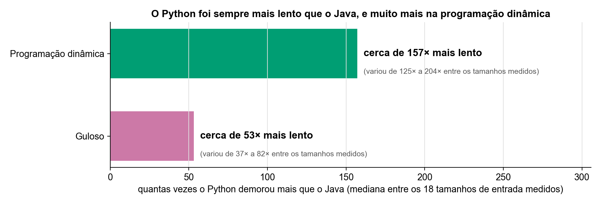

# Troco de moedas: guloso × programação dinâmica

**CESAR School** · Ciência da Computação · **Teoria da Computação** · Prof. Daniel Bezerra · Turma B · Grupo 7


## O que é este projeto

Você precisa pagar um valor (por exemplo, R$ 0,30) usando o **menor número possível de moedas**. Com moedas de 25, 10, 5 e 1 centavo, a melhor resposta são 2 moedas: 25 + 5.

Escrevemos duas maneiras de resolver isso e comparamos as duas:

- **Algoritmo A, o guloso.** A regra é simples: "pegue sempre a maior moeda que cabe no que ainda falta pagar". Em 30 centavos, ele pega 25, sobram 5, pega 5 e termina. É muito rápido, porque olha cada tipo de moeda uma vez só. Só que **às vezes erra**. Com moedas de 1, 3 e 4 centavos e um valor de 6, ele pega 4 + 1 + 1 (3 moedas), mas o melhor seria 3 + 3 (2 moedas). Com o nosso sistema de moedas (o real), ele acerta sempre.
- **Algoritmo B, a programação dinâmica (PD).** Ela resolve os valores pequenos primeiro e reaproveita as respostas nos maiores. Descobre o melhor jeito de pagar 1 centavo, depois 2, depois 3, e assim por diante até o valor pedido. Para cada valor, testa cada moeda e usa a resposta que já tinha anotado. **Sempre acerta**, mas demora mais quanto maior for o valor, porque precisa preencher essa lista inteira.

Em resumo: o guloso é rápido e às vezes erra, e a PD sempre acerta, mas é mais lenta. Medimos o tamanho dessa diferença.

Os dois algoritmos foram escritos em **Python** e em **Java** (4 implementações), rodaram sobre as mesmas entradas e foram comparados com o que a teoria prevê.

## Principais links

<table>
  <tr>
    <td align="center" width="33%">
      <a href="relatorio/relatorio_troco_de_moedas_v1.pdf"></a>
      <br><b>Relatório (PDF)</b>
      <br>Os 7 itens do enunciado, ambiente, contribuições e declaração de IA. Clique para abrir.
    </td>
    <td align="center" width="33%">
      <a href="resultados/resumo.csv"></a>
      <br><b>Resultados medidos</b>
      <br>Média e desvio-padrão por tamanho (<code>resumo.csv</code>). Os dados brutos e o ajuste log-log estão em <a href="resultados/">resultados/</a>.
    </td>
    <td align="center" width="33%">
      <a href="graficos/"></a>
      <br><b>Gráficos</b>
      <br>Guloso × PD, Python × Java, casos e memória. Clique para ver todos.
    </td>
  </tr>
</table>

## Entregas

| Exigência do enunciado | Onde está |
|---|---|
| 4 implementações (2 algoritmos × 2 linguagens) | [src/python/troco.py](src/python/troco.py), [src/java/Troco.java](src/java/Troco.java) |
| Script de geração de entradas (semente fixa) | [scripts/gerar_entradas.py](scripts/gerar_entradas.py) → [entradas/](entradas/) |
| Script de medição | [src/python/medir.py](src/python/medir.py), [src/java/Medir.java](src/java/Medir.java) |
| Testes de corretude | [testes/test_troco.py](testes/test_troco.py) |
| Scripts dos gráficos | [scripts/graficos.py](scripts/graficos.py), [scripts/analisar_sistemas.py](scripts/analisar_sistemas.py) |
| Resultados brutos | [resultados/](resultados/) |
| Relatório PDF (7 itens, ambiente, contribuições, declaração de uso de IA) | [relatorio/](relatorio/) |
| README reprodutível | este arquivo · tudo roda com [scripts/rodar_tudo.py](scripts/rodar_tudo.py) |

## Pastas

Estrutura dos experimentos originais (E1/E2); E3 acrescenta `scripts/estudar_caso_medio.py`, `scripts/validar_resultados.py`, `entradas/bench_medio.txt`, `testes/test_experimentos.py`, `resultados/caso_medio/` e `graficos/fig7_caso_medio.png`:

```
.
├── README.md                          este arquivo
├── requirements.txt                   bibliotecas dos gráficos (matplotlib, numpy)
├── .gitignore                         ignora arquivos gerados (build/, caches, .venv/)
│
├── src/                               as 4 implementações e os medidores
│   ├── python/
│   │   ├── troco.py                   guloso e PD em Python
│   │   └── medir.py                   cronometragem e memória em Python
│   └── java/
│       ├── Troco.java                 guloso e PD em Java
│       └── Medir.java                 cronometragem e memória em Java
│
├── scripts/                           geração, execução e análise
│   ├── gerar_entradas.py              cria as entradas (semente fixa 2026)
│   ├── rodar_tudo.py                  roda tudo de ponta a ponta (--rapido para a versão curta)
│   ├── graficos.py                    gera resumo.csv, ajustes.csv e os gráficos
│   └── analisar_sistemas.py           analisa sistemas de moedas aleatórios (quando o guloso erra)
│
├── testes/
│   └── test_troco.py                  testes automáticos: as 4 implementações dão a mesma resposta
│
├── entradas/                          instâncias lidas pelas 4 implementações
│   ├── bench_V.txt                    experimento E1: varia o valor V
│   ├── bench_n.txt                    experimento E2: varia o número de moedas n
│   ├── contraexemplos.txt             sistemas em que o guloso erra
│   └── aleatorias.txt                 instâncias pequenas aleatórias (testes)
│
├── resultados/                        dados medidos
│   ├── tempos_python_V.csv            tempos brutos, Python, E1
│   ├── tempos_python_n.csv            tempos brutos, Python, E2
│   ├── tempos_java_V.csv              tempos brutos, Java, E1
│   ├── tempos_java_n.csv              tempos brutos, Java, E2
│   ├── memoria_python.csv             memória medida, Python
│   ├── memoria_java.csv               memória medida, Java
│   ├── resumo.csv                     média, desvio-padrão e razão T/f por tamanho
│   ├── ajustes.csv                    expoentes log-log
│   ├── sistemas_aleatorios.csv        resultado da análise de sistemas aleatórios
│   └── ambiente.txt                   CPU, RAM, sistema e versões usadas
│
├── graficos/                          figuras do relatório
│   ├── fig1_teorico_vs_medido.png     razão T/f tende a uma constante
│   ├── fig2_guloso_vs_pd.png          algoritmo × algoritmo
│   ├── fig3_python_vs_java.png        linguagem × linguagem
│   ├── fig4_casos.png                 melhor, médio e pior caso
│   ├── fig5_memoria.png               uso de memória
│   └── fig6_sistemas_pizza.png        em quantos sistemas o guloso nunca erra
│
└── relatorio/
    ├── relatorio_troco_de_moedas_v1.pdf   relatório completo
    ├── miniatura_capa.png                 imagem usada no link do README
    └── miniatura_resultados.png           imagem usada no link do README
```

## Como funciona

Pense num caixa de supermercado. O **guloso** é o caixa experiente: pega a maior nota que cabe no troco e repete. A **PD** é o caixa cuidadoso: antes de responder, anota num caderno o melhor troco para R$ 0,01, R$ 0,02, … até o valor pedido.

1. `gerar_entradas.py` cria as instâncias (valor V e lista de moedas) com semente fixa e grava em `entradas/`.
2. As quatro implementações leem os mesmos arquivos.
3. `medir.py` / `Medir.java` cronometram **o lote de chamadas do algoritmo** (o laço do lote e a soma das respostas entram; leitura e escrita ficam fora), em lotes de N chamadas (N dobra até o lote durar ≥ 10 ms), com 20 repetições, aquecimento e descarte.
4. `test_troco.py` confere: PD = força bruta, Java = Python, guloso = PD nos sistemas em que o guloso acerta (como o real) e guloso ≠ PD nos casos em que ele erra.
5. `graficos.py` calcula média, desvio-padrão, razão T(n)/f(n), expoente log-log e desenha as figuras.

## Como reproduzir

Antes de começar, veja os [pré-requisitos](#pré-requisitos-para-executar) no fim deste arquivo.

```bash
python -m venv .venv
# Windows: .venv\Scripts\activate    |    Linux/macOS: source .venv/bin/activate
pip install -r requirements.txt

python scripts/rodar_tudo.py --rapido   # demonstração reduzida, saída em saida_rapida/
python scripts/rodar_tudo.py            # completo: E1/E2 + E3; duração depende da máquina
```

Só o caso médio ampliado: `python scripts/estudar_caso_medio.py` (ou `--rapido` para demonstrar).

Só os testes: `python -m unittest discover -s testes -v` (compila o Java sozinho).

### Rodar cada parte separadamente

Todos os comandos partem da raiz do repositório.

```bash
python scripts/gerar_entradas.py                       # recria entradas/ (semente 2026)

javac -d build src/java/*.java                         # compila o Java
java -cp build Medir tempo entradas/bench_V.txt saida_java.csv --reps 20
python src/python/medir.py tempo entradas/bench_V.txt saida_python.csv --reps 20

python scripts/graficos.py --resultados resultados --graficos graficos
```

Modos do medidor (iguais em Python e Java): `tempo` (cronometra), `memoria` (pico de memória de uma chamada) e `respostas` (só grava a resposta de cada algoritmo, usado nos testes). As opções `--max-V` e `--max-n` limitam o tamanho das instâncias para rodar mais rápido.

### Formato dos arquivos de entrada

Uma instância por linha; linhas que começam com `#` são comentários:

```
id experimento caso V n c1 c2 ... cn
V_medio_00 E1 medio 1016 13 20000 10000 5000 2000 1000 500 200 100 50 25 10 5 1
```

As moedas vêm em ordem **decrescente** (pré-condição do guloso). A PD devolve o menor número de moedas, ou `-1` se não há solução. O guloso devolve sua escolha; em sistemas não canônicos pode usar moedas a mais ou retornar `-1` mesmo existindo solução. O leitor compartilhado exige V entre 0 e 2³¹ − 3, moedas positivas, distintas, decrescentes, quantidade n correta e IDs únicos.

## Respostas às perguntas do enunciado

1. **Problema e algoritmos:** guloso (maior moeda primeiro, com divisão inteira) e PD (`dp[v] = min(dp[v−c] + 1)`). Relatório, seção 1.
2. **Classificação:** guloso O(n) e Ω(1) no laço (Θ(n) no pior caso, Θ(1) no melhor), O(n log n) contando a ordenação. PD O(n·V) de tempo, Θ(n·V) quando todas as moedas são ≤ V/2, e Θ(V) de espaço. Seção 2.
3. **Casos:** guloso melhor = V múltiplo da maior moeda (1 iteração); pior = o resto só zera na última moeda (n iterações); médio (n+1)/2 iterações no sistema {1,…,n}, com resto uniforme e V positivo. Para C e V fixos, a quantidade de iterações da PD é determinada; mudar as denominações pode mudar o trabalho. Seção 3.
4. **Aplicabilidade:** guloso em sistemas de moedas em que ele acerta (real, euro, dólar), com qualquer V. PD em sistemas arbitrários com V moderado. Seção 4.
5. **Simulação:** E1 varia V de 10³ a 10⁷ (9 tamanhos); E2 varia n de 4 a 1024 (9 tamanhos) nos 3 casos. E3 varia n de 4 a 256 (7 tamanhos), com 20 entradas distintas e V próximo de 10.000. Seção 5.
6. **Gráficos e tabelas:** teórico × medido, algoritmo × algoritmo, linguagem × linguagem, casos e memória. Seção 6.
7. **P × NP:** a decisão "dá para pagar V com ≤ k moedas?" está em NP (o certificado são as quantidades) e é NP-completa (Lueker, 1975). A PD é **pseudopolinomial**: polinomial no valor de V, exponencial no número de dígitos de V, então não prova que o problema está em P. **Problema vizinho:** troco no caso geral (moedas arbitrárias, V em binário), NP-difícil no sentido fraco; já o troco num sistema canônico fixo, como o real, está em P (guloso O(n)). O guloso não tem garantia de aproximação: em {1, k, k+1} com V = 2k usa k moedas contra 2. Seção 7.

## Caso médio ampliado (E3)

O comando `python scripts/estudar_caso_medio.py` executa as quatro implementações em **140 entradas**: n = 4, 8, 16, 32, 64, 128 e 256, com **20 valores V distintos por tamanho** e **20 repetições por entrada**. O gerador usa uma RNG independente (semente 2027), amostragem uniforme sem reposição em um intervalo de 10·n inteiros alinhado a múltiplos de n, próximo de V = 10.000. A população possui distribuição uniforme de V mod n; uma amostra finita pode se afastar da esperança (n+1)/2.

- [Dados brutos e ambiente](resultados/caso_medio/): 11.200 medições, quatro implementações nas mesmas entradas.
- [Resumo por entrada](resultados/caso_medio/resumo_por_entrada.csv): média e desvio temporal de 20 repetições.
- [Resumo por tamanho](resultados/caso_medio/resumo_por_tamanho.csv): média das 20 médias; desvio entre entradas e desvio temporal médio em colunas separadas.
- [Figura do caso médio](graficos/fig7_caso_medio.png): barras indicam desvio **entre entradas**, não intervalo de confiança.
- [Expoentes ajustados](resultados/caso_medio/ajustes.csv): ajuste log-log das médias por tamanho.

E1/E2 são os experimentos originais. E3 foi executado posteriormente em outro ambiente, descrito no arquivo próprio. Os gráficos comparam linguagens e algoritmos dentro do mesmo experimento; não se calculam razões entre máquinas diferentes. Nesta revisão, os dados anteriores não foram apagados nem sobrescritos. Executar novamente o comando completo substitui os CSV e gráficos gerados pelos novos tempos da máquina; o PDF registra as execuções publicadas e não muda automaticamente.

O modo `--rapido` do E3 usa 3 tamanhos, 2 entradas por tamanho e 3 repetições: serve apenas para conferir a reprodução, **não substitui** o experimento completo exigido pelo professor. O comando completo de `rodar_tudo.py` inclui E3 ao final. A validação rejeita entradas malformadas, falta de implementações, repetições ausentes ou duplicadas, tempos não finitos, metadados inconsistentes e respostas divergentes.

## Resultados principais

Tempo médio por chamada, experimento E1 (sistema do real em centavos, n = 13, 20 repetições):

| V | Guloso Python | Guloso Java | PD Python | PD Java |
| ---: | ---: | ---: | ---: | ---: |
| 1.016 | 590,3 ns | 8,2 ns | 453,20 µs | 3,25 µs |
| 3.203 | 659,7 ns | 8,1 ns | 1,85 ms | 11,02 µs |
| 10.065 | 583,2 ns | 7,9 ns | 7,67 ms | 37,60 µs |
| 31.689 | 1,27 µs | 17,8 ns | 27,80 ms | 158,40 µs |
| 100.083 | 619,1 ns | 11,6 ns | 87,52 ms | 554,20 µs |
| 316.242 | 883,2 ns | 18,3 ns | 318,40 ms | 1,86 ms |
| 1.000.029 | 591,3 ns | 9,0 ns | 961,40 ms | 6,43 ms |
| 3.162.355 | 681,9 ns | 13,5 ns | 2,87 s | 19,89 ms |
| 10.000.080 | 629,9 ns | 11,3 ns | 9,84 s | 78,55 ms |

[](graficos/)

[](graficos/)

Clique em uma imagem para abrir a pasta com todos os gráficos.

- PD: expoente log-log 1,07 (Python) e 1,10 (Java), perto do 1 previsto por Θ(n·V).
- Guloso: tempo constante em V (expoente 0,00 / 0,05).
- Com V = 10.000.080: PD 9,84 s (Python) e 78,55 ms (Java); guloso 629,9 ns e 11,3 ns.
- Na PD o Python foi de 125 a 204 vezes mais lento que o Java. A constante muda; o expoente, não.

**Limitações:**

- E1/E2 preservam o experimento original, com uma entrada aleatória por tamanho. O estudo E3 amplia o caso médio para 20 entradas distintas em cada um de 7 tamanhos, com 20 repetições por entrada. E3 tem ambiente próprio registrado; seus tempos absolutos não são misturados aos de E1/E2.
- A PD Java rejeita V negativo ou maior que Integer.MAX_VALUE - 2; mesmo dentro desse intervalo, a tabela precisa caber na memória. O maior V medido foi 10.000.080.
- Os tempos do guloso Java são custos médios de chamadas em lote, sujeitos a otimizações do JIT; o acumulador não exclui todas essas otimizações. Não são uma medição de latência isolada nem uma comparação universal entre linguagens.
- Os CSV publicados preservam a execução original descrita no relatório. Os ajustes de validação não modificam as transições da PD; uma nova execução produz seus próprios tempos.


- Os tempos absolutos dependem da máquina em que se roda; as tendências, não. A máquina usada nas medições está descrita no relatório.
- A PD em Python vai só até V = 10⁷ por causa do tempo e da memória.
- O guloso só foi medido em sistemas de moedas em que ele acerta. Nos outros ele é igualmente rápido, mas erra (relatório, Tabela 2).

## Extras do projeto

| Extra | Por quê |
|---|---|
| Medição de memória e comparação com Θ(V) ([fig5](graficos/fig5_memoria.png)) | Bônus de até 0,5 previsto no enunciado |
| Verificação automática de que, nos sistemas de moedas do benchmark, o guloso acerta (limite de Kozen e Zaks) | Garante que as 4 implementações devem coincidir; reduz o risco de erro |
| Análise de sistemas aleatórios ([scripts/analisar_sistemas.py](scripts/analisar_sistemas.py), [fig6](graficos/fig6_sistemas_pizza.png)) | Dá números concretos ao item 4 (com que frequência o guloso erra) |
| Expoente do ajuste log-log ([resultados/ajustes.csv](resultados/ajustes.csv)) | Compara teoria e medição com um número, além do gráfico |
| Modo `--rapido` | Qualquer pessoa confere a reprodução em cerca de 1 minuto |

## Pré-requisitos para executar

- **Python 3.10 ou mais novo**, com `python` e `pip` funcionando no terminal.
- **JDK (Java) 21 ou mais novo**, com `java` e `javac` funcionando no terminal.
- As bibliotecas `matplotlib` e `numpy`, instaladas com `pip install -r requirements.txt` (usadas só para os gráficos).
- Windows, Linux ou macOS.
- Para o modo completo, deixe o computador sem outros programas pesados abertos, porque o tempo medido depende disso. O modo `--rapido` não exige cuidado.

## Contribuições

O que cada integrante fez e a declaração exigida pela disciplina estão nas seções 9 e 10 do [relatório](relatorio/relatorio_troco_de_moedas_v1.pdf).

## Equipe

- Erick Acioli Belo
- José Braz
- Luis Guilherme Alves
- Júlio Cesar
- João Luiz
